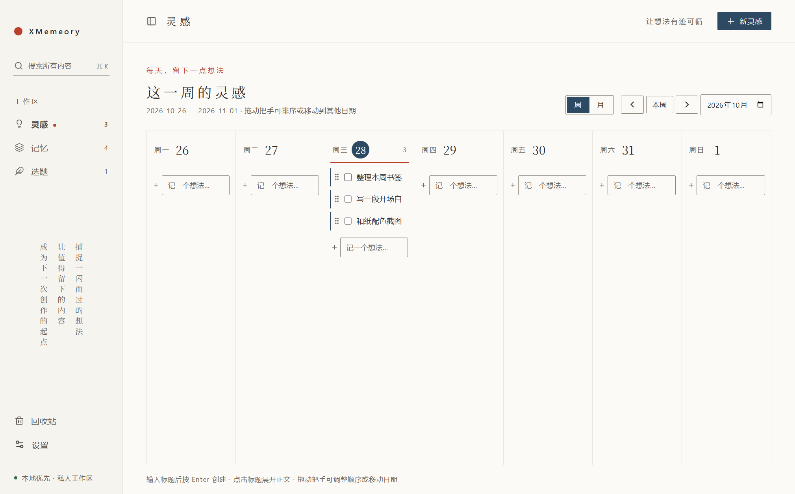
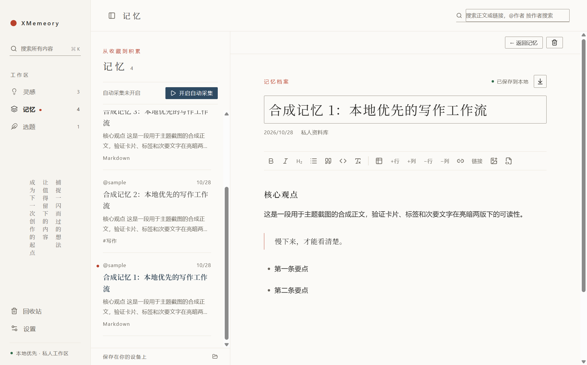
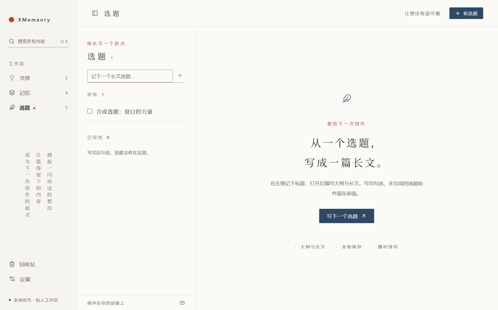
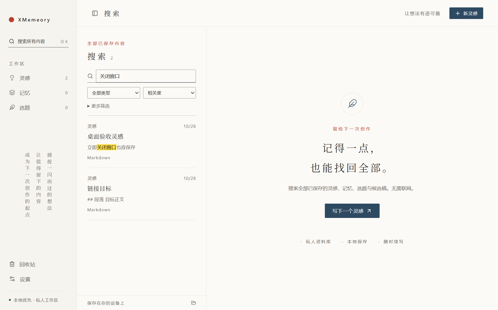
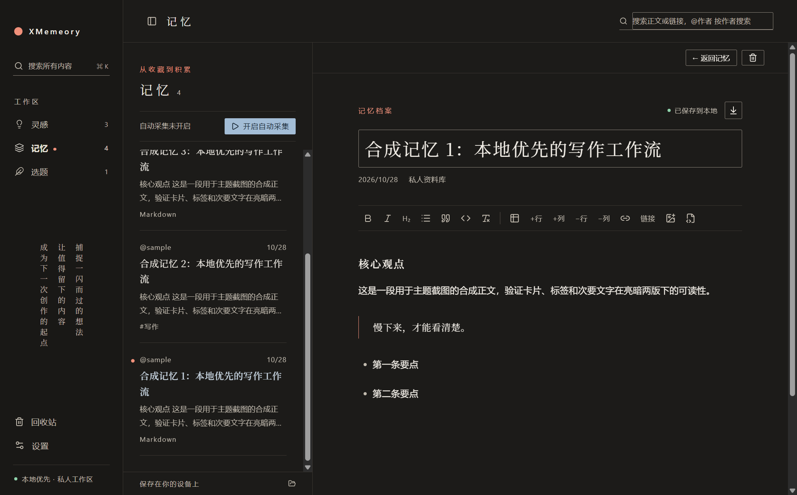

<div align="center">

[](https://github.com/Andrew-liu/XMemory)

</div>

<h1 align="center">XMemeory</h1>

<div align="center">

[](ChangeLog.md) [](https://github.com/Andrew-liu/XMemory/tags) [](LICENSE) [](#下载与安装)<br>
[](https://www.electronjs.org/) [](https://react.dev/) [](https://www.typescriptlang.org/) [](#数据与隐私) [](https://github.com/Andrew-liu/XMemory/stargazers)

</div>

<p align="center"><b>记录灵感，积累记忆，展开长文。</b></p>

<div align="center">



</div>

## 项目介绍

**XMemeory 是一款本地优先的桌面写作工作区**，把每天冒出的短推灵感、从 X 书签积累的参考资料和准备展开的长文选题，放进同一个安静的空间。

所有内容直接保存为 Markdown 文件，可以用任何编辑器打开；需要多台设备时，再用你自己的 GitHub 私有仓库双向同步。没有账号体系，没有云端服务，数据始终在你手里。

如果这个项目对你有帮助，欢迎点个 Star，我们会持续打磨。

## 为何开发 XMemeory

灵感散落在备忘录，收藏沉睡在书签栏，长文选题停留在脑海里。三者本该互相滋养，却分处不同的工具：想写的时候找不到素材，翻到素材时又忘了当初的想法。

XMemeory 用三个工作区串起这条链路：**灵感**按日记录、**记忆**自动沉淀、**选题**展开成文，并以全局搜索和双向链接把它们连在一起。界面采用和风极简设计，用留白和细线代替卡片与阴影，让注意力回到文字本身。

## 功能特性

- 灵感日历：按周或按月查看，输入标题即可记录，一条灵感就是一条待办，可拖动排序或移到其他日期
- X 书签自动采集：每小时增量采集，保留正文、原文链接、原图与长文结构，自带限额与熔断保护
- 长文选题：在同一篇文档里写大纲和正文，写完勾选划线，未完成的始终在前
- 所见即所得的 Markdown 编辑：富文本与源码一键切换，支持表格、链接、双向链接、笔记嵌入与一键清除格式
- 全局搜索：覆盖灵感、记忆、选题和候选稿，命中关键词黄色高亮，点击结果直接定位到正文
- GitHub 私有仓库双向同步：启动时与每 10 分钟自动同步，冲突时保留双方并支持手动合并
- 和纸主题：亮、暗两版，正文与标题使用随应用打包的思源宋体，暗版专门校准文字对比度
- 本地优先：正文为 Markdown，图片存在本地，删除先进回收站，Token 本机加密且不参与同步

## 三个工作区

| 工作区 | 用来做什么                     | 核心能力                                                     |
| ------ | ------------------------------ | ------------------------------------------------------------ |
| 灵感   | 每天随手记下一闪而过的想法     | 周/月日历、快速创建、勾选已使用、拖拽排序与跨日移动          |
| 记忆   | 把 X 书签沉淀成可检索的资料库  | 自动增量采集、长文与原图保存、不完整内容补采、按发布时间排序 |
| 选题   | 把一个长文想法写成完整文章     | 待写/已写完分组、大纲与正文同文档、随时续写与撤销完成        |

## 产品演示

<div align="center">

|               记忆阅读               |              长文选题              |
| :----------------------------------: | :--------------------------------: |
|  |  |

|              全局搜索               |                 暗色模式                  |
| :---------------------------------: | :---------------------------------------: |
|  |  |

</div>

> 演示截图均来自自动化测试中的合成资料库，不包含真实用户数据。

## 功能详解

<details>
<summary><b>灵感</b></summary>

- 默认按周展示，可切换查看整月。
- 每天输入标题按 Enter 即可记录，点击灵感展开正文。
- 一个灵感就是一条待办，已使用的灵感勾选划线，支持撤销。
- 未完成的灵感保留在当天，不催办；同一天未完成项排在前面。
- 支持拖动调整顺序或移动到其他日期。

</details>

<details>
<summary><b>记忆与 X 书签采集</b></summary>

- 在设置中开启“在这台电脑上自动采集书签”后，每小时增量采集一次，已采集过的自动跳过；同一 X 账号只建议在一台电脑上开启。
- 保存正文、原文链接和原图，不下载视频文件；长文保留标题、列表、引用、代码块、封面和原位配图，内嵌视频保留封面；短推的短链接还原为真实地址。
- 记忆页顶部显示采集状态，一个按钮即可暂停或开启，与设置中的开关同步。
- 采集自带限额与保护：每天最多新增 200 条（其中长文 50 篇），每轮最多 100 条（历史回溯完后 50 条）；遇到登录失效、限流、额度已满会跳过并说明原因，不弹窗。
- 记忆按卡片上显示的时间从新到旧排列：有发布时间用发布时间，没有则用保存时间。
- 右上角一个搜索框：搜正文或链接，`@作者` 按作者搜索，输入“不完整”筛出不完整记忆；列表与卡片视图可在设置中切换。
- 图片保存失败时保留远程链接。不完整记忆可在详情页手动重新采集；开启自动采集后，还会在正常书签轮结束时尝试补采一条，每天最多 3 次、同条至少间隔 6 小时，连续 3 次未补全则等待人工处理。
- 自动补采仅在可核验原 X 正文未被修改时替换原文，并保留“我的笔记”。

> 采集使用本机正式版 Google Chrome 的独立 Profile，首次需在 Chrome 中手动登录 X。自动采集默认关闭，需手动开启；不采集推文串、回复和引用推文正文。

</details>

<details>
<summary><b>选题与候选稿</b></summary>

- 独立记录长文想法，每个选题是一条待办。
- 点击选题，在同一篇文档中编写大纲和长文。
- 已写完的选题划线，未完成项始终排在已完成项前面；支持继续编辑、撤销完成和搜索历史选题。
- v0.5.1 起移除了 AI 创作与模型配置。此前生成的候选稿仍保留在资料库中，可通过全局搜索打开、编辑并返回原灵感，也照常参与同步。

</details>

<details>
<summary><b>编辑器与图片</b></summary>

- Markdown 源码与富文本切换，支持表格、链接、双向链接和笔记摘要嵌入。
- 工具栏提供“清除格式”：去掉选中内容的加粗、斜体、行内代码和链接，并把标题、列表、引用、代码块恢复为普通段落。
- 按 Enter 新起段落，按 Shift+Enter 段内换行；从网页或聊天软件粘贴的多行内容会自动拆成独立段落，间距保持一致。
- 自动保存，支持在外部编辑 Markdown 后回读。
- 直接粘贴图片到正文，图片保存在本地；双击放大、查看原始尺寸、右键复制，另提供邮件富文本复制。
- 导出当前笔记的 Markdown 和正文直接引用的本地图片，不携带其他笔记或无关附件。

</details>

<details>
<summary><b>全局搜索</b></summary>

- 搜索已保存的灵感、记忆、选题和候选稿，支持类型、作者、标签和日期筛选。
- 标题与摘要中的命中关键词以黄色高亮。
- 点击结果滚动并选中正文匹配位置，结果列表顺序保持不变；源码中的匹配可切换源码定位。

</details>

<details>
<summary><b>私有同步与数据管理</b></summary>

- 支持 GitHub 私有仓库双向同步；配置完成后，应用每次启动会在后台同步一次，运行期间每 10 分钟继续检查，也可手动触发。
- 每次同步先检查远端是否有新提交：有更新先拉取并合并到本地，再上传本地修改；上传时若远端又有变化，自动重新拉取后重试（最多 3 次）。
- 跳过未变化文件的下载，复用已校验的本地内容或缓存；显示本轮拉取、上传、下载与复用数量。
- 冲突时保留双方，展示正文与附加字段差异，可选择版本、保留两份或手动合并；仅换行格式或 YAML 写法不同时不产生冲突。
- 删除的内容进入回收站，支持恢复。

</details>

<details>
<summary><b>外观与系统集成</b></summary>

- 和纸主题提供亮色、暗色和跟随系统三种模式；主按钮在任何模式下都与背景保持明显对比。
- 正文与标题使用思源宋体，字体随应用打包，离线也能正确显示。
- 支持关闭窗口后驻留托盘；可在设置中开启开机自启（默认关闭，仅安装版可用），开机后只在托盘中启动。若本机已开启自动采集，启动后等待约 3～8 分钟再开始首轮。
- 设置页“关于”显示实际运行版本与应用源码仓库；它不同于你自己配置的 GitHub 私有数据同步仓库。

</details>

## 下载与安装

源码通过 Git 版本标签发布，可在 [Tags](https://github.com/Andrew-liu/XMemory/tags) 页面获取。当前版本为 0.6.0，暂未提供公开的安装包下载，可按下文自行构建 Windows 免安装版。

- 运行环境：Windows 10/11 x64
- X 书签采集：需要本机安装正式版 Google Chrome
- 数据目录：`%APPDATA%\XMemeory`，安装版与免安装版共用
- 安装包未签名，首次运行可能出现 Windows SmartScreen 提示

## 开发与构建

环境要求：Node.js `^20.19.0` 或 `>=22.12.0`，pnpm 11（项目通过 `packageManager` 字段锁定版本）。

```sh
# 安装依赖，并下载 Electron 运行时
pnpm install
pnpm exec install-electron

# 开发模式（Electron 窗口 + 渲染端热更新）
pnpm dev

# 生产构建并运行
pnpm build
pnpm start

# Windows 安装包（NSIS），输出至 release/
pnpm pack:win

# Windows 免安装版，输出 release/win-unpacked/
pnpm build
pnpm exec electron-builder --win --x64 --dir

# macOS 安装包（需在 macOS 上执行）
pnpm pack:mac
```

> 打包命令存在不代表已完成跨平台验收与代码签名；macOS 包尚未验收。

## 测试

```sh
# 类型检查
pnpm typecheck

# 核心单元测试（Vitest）
pnpm test

# 真实 Electron 窗口测试，需先 pnpm build
pnpm test:desktop      # 桌面验收：保存、回读、表格、粘贴、搜索、设置等
pnpm test:topics       # 长文选题
pnpm test:calendar     # 灵感日历
pnpm test:memory       # 记忆阅读与排序
pnpm test:themes       # 和纸亮暗主题与对比度
pnpm test:recovery     # 单实例与退出恢复
pnpm test:clean-exit   # 无编辑退出
```

`tests/` 下另有搜索定位、图片复制、同步缓存、冲突处理等专项，可用 `pnpm exec tsx tests/<文件名>.ts` 运行。设置环境变量 `XMEMEORY_TEST_EXE` 指向打包后的 `XMemeory.exe`，即可对安装包做同样的冒烟测试。Lint 尚未配置。

## 技术栈

| 层级     | 选型                                              |
| -------- | ------------------------------------------------- |
| 桌面外壳 | Electron 44、electron-vite、electron-builder       |
| 界面     | React 19、TypeScript、Tiptap 3 编辑器、Lucide 图标 |
| 数据     | Markdown 文件为权威正文，SQLite FTS 为可重建索引  |
| 采集     | Playwright 连接本机 Chrome 独立 Profile           |
| 同步     | GitHub REST API，私有仓库双向同步                 |
| 测试     | Vitest 单元测试 + Playwright 驱动的真实窗口测试   |

## 数据与隐私

- 内容只保存在本机，正文为标准 Markdown，可随时用其他编辑器打开或整体迁移。
- 不内置任何云端服务，不收集遥测；只有你主动配置的 GitHub 私有仓库会收到同步内容。
- GitHub Token 使用系统能力在本机加密保存，不写入资料库，也不参与同步。
- 本地索引可随时从 Markdown 文件完整重建，删除索引不会丢失内容。

## 项目结构

```text
XMemory/
├── src/
│   ├── main/        # 主进程：本地文件、凭据、采集、同步
│   ├── preload/     # 受限 IPC 桥接
│   ├── renderer/    # 界面与编辑器
│   └── shared/      # 主题、类型与共享逻辑
├── tests/           # 单元测试与真实 Electron 窗口测试
├── docs/images/     # README 图片
├── Design.md        # 各版本设计方案
└── ChangeLog.md     # 各版本变更记录
```

## 参与贡献

欢迎通过 [Issues](https://github.com/Andrew-liu/XMemory/issues) 反馈问题或提出建议。每个版本的设计方案记录在 [Design.md](Design.md)，变更记录见 [ChangeLog.md](ChangeLog.md)，提交代码前请阅读 [AGENTS.md](AGENTS.md) 中的开发约定。

## 协议

本项目采用 [MIT License](LICENSE) 开源，版权权利人署名待确认。
